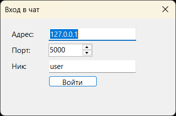
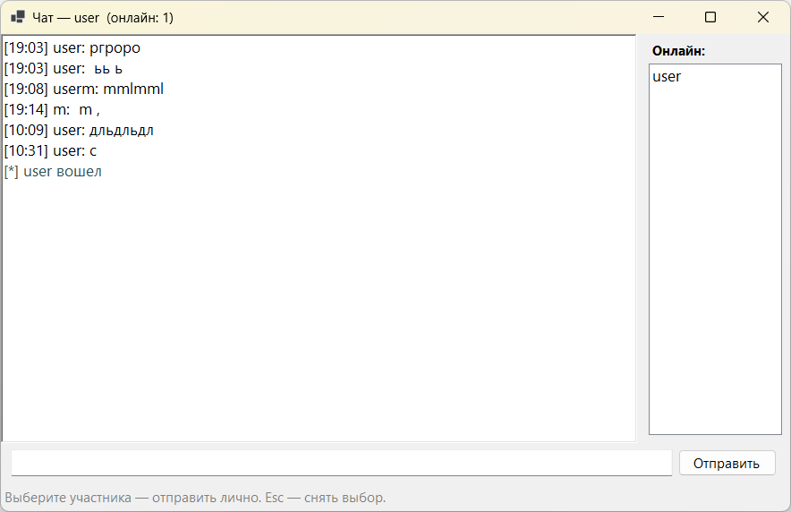

## Лабораторная 3: Онлайн-чат

**Состав команды:**
*   Чумаков Александр — Разработка клиента, интерфейс, тестирование.
*   Лисина Анастасия — Разработка сервера, история сообщений, тестирование.

### Скриншоты

### Как запустить
1. Запустить сервер: в папке `ChatServer` выполнить `dotnet run` (или запустить через Visual Studio F5). Сервер слушает порт 5000.
2. Запустить клиент: в папке `ChatClient` выполнить `dotnet run`.
3. В окне входа ввести IP сервера (127.0.0.1), порт (5000) и ник. Нажать «Войти».

### Протокол
Одно сообщение = одна строка JSON. Сериализация выполняется стандартным `System.Text.Json`, поэтому поля пишутся с большой буквы. Формат:
`{"Type": "text", "Nick": "vasya", "Text": "привет", "Time": "2026-11-18T14:03:00", "To": null}`

Типы сообщений:
- `login` (клиент -> сервер): запрос на вход
- `login_ok` (сервер -> клиент): успешный вход
- `login_fail` (сервер -> клиент): ник занят
- `text` (клиент -> сервер -> все): публичное сообщение
- `private` (клиент -> сервер -> адресат): личное сообщение (★)
- `system` (сервер -> все): уведомление о входе/выходе
- `users` (сервер -> все): список онлайн (JSON-массив строк в поле Text)
- *История (★★): при успешном входе сервер отправляет 20 последних сообщений подряд с типом `text`.*

### Устройство проекта
- **ChatCommon** — общие классы `ChatMessage` (модель сообщения) и константы `Protocol`.
- **ChatServer** — сервер. `ChatServer` (управление клиентами под lock), `ClientHandler` (поток на клиента), `HistoryStore` (сохранение в файл).
- **ChatClient** — клиент. `ChatClient` (сеть в фоновом потоке, паттерн Наблюдатель), `LoginForm`, `ChatForm`.

### Чек-лист
- [x] Сервер и клиент (отдельные программы)
- [x] Адрес и порт вводятся в окне входа
- [x] Вход по нику, отказ при занятом нике
- [x] Уведомления о входе и выходе
- [x] Лента с ником и временем
- [x] Отправка кнопкой и Enter
- [x] Список онлайн актуален
- [x] Классы и протокол (клиент не зависит от окна, паттерн Наблюдатель)
- [x] Окно не зависает (сеть в отдельном потоке, обновление через BeginInvoke)
- [x] Отключение клиента не ломает сервер
- [x] Недоступный сервер: сообщение, а не вылет
- [x] README (описание, протокол, чек-лист)
- [x] ★ Личные сообщения (видят двое, выделены цветом)
- [x] ★★ История (20 сообщений, переживает рестарт)
